<div align="center">

# 경쟁 분석 리서치 플랫폼

**검색어 한 줄로 경쟁사 식별부터 기능 비교, 실사용자 반응 분석, 리서치 리포트까지 자동으로 만드는 멀티 에이전트 분석 도구**


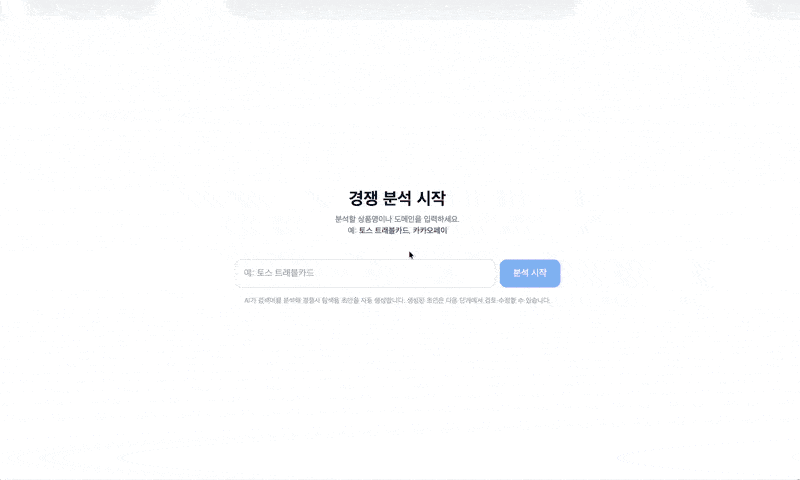

<sub>검색어 입력 → 초안 검토 → 경쟁사 선택 → 분석 항목 선택 → 리포트 생성까지의 실행 흐름</sub>

</div>

<p align="center">
  <a href="#한눈에-보기">한눈에 보기</a> ·
  <a href="#1-해결하려는-문제">문제 정의</a> ·
  <a href="#2-주요-화면과-산출물">주요 화면</a> ·
  <a href="#3-동작-방식">동작 방식</a> ·
  <a href="#4-설계-결정">설계 결정</a> ·
  <a href="#5-개선-과정과-성과">개선과 성과</a> ·
  <a href="#6-기술-스택">기술 스택</a> ·
  <a href="#7-실행-방법">실행 방법</a> ·
  <a href="#8-프로젝트-구조">프로젝트 구조</a> ·
  <a href="#9-한계와-다음-단계">한계와 다음 단계</a> ·
  <a href="#10-문서">문서</a> ·
  <a href="#만든-사람">만든 사람</a>
</p>

---

## 한눈에 보기

> 수작업으로 며칠씩 걸리던 경쟁 분석을 **파이프라인 1회 실행, 약 1시간~1시간 30분**으로 끝냅니다. 사용자는 그동안 검토 지점 4곳에서 확인만 하면 됩니다.

| 입력                    | 처리                                                          | 출력                           |
| --------------------- | ----------------------------------------------------------- | ---------------------------- |
| `토스 트래블카드` 같은 검색어 한 줄 | 30여 개 LangGraph 노드가 경쟁사 탐색, 공식 정보/YouTube/커뮤니티 데이터를 수집하고 분석 | 비교 매트릭스, 고객 반응 인사이트, 리서치 리포트 |

- **사람과 AI가 나눠서 판단합니다.** 4개 검토 지점(Human-in-the-loop)에서 사용자가 도메인 분석 초안, 경쟁사 선택, 수집된 URL/분석 항목을 직접 확정하므로, 잘못된 후보가 이후 단계를 오염시키지 않습니다.
- **공식 스펙과 실제 사용자 반응을 하나의 ID 체계로 연결합니다.** 자사 `own_*`, 경쟁사 `comp_*`, 분석 항목 `feat_*`로 "무엇을 내세우는가"와 "사용자는 어떻게 느끼는가"를 같은 표에서 비교합니다.
- **다시 실행해도 같은 결과가 나옵니다.** 입력 해시 기반 캐시, JSON Schema 강제, 결정론적 ID 정규화로 재현성을 확보했습니다.


---

## 1. 해결하려는 문제

경쟁 분석에 생성형 AI를 쓰는 가장 쉬운 방법은 챗봇에 프롬프트로 묻는 것입니다. 빠르지만, 그 결과를 그대로 업무 근거로 쓰기에는 다음과 같은 한계가 있습니다.

- **근거를 확인할 수 없음**: 존재하지 않는 URL이나 수치를 그럴듯하게 만들어 내고(환각), 각 내용이 어느 출처에서 왔는지 추적하기 어렵습니다.
- **반응을 셀 수 없음**: 사용자 반응을 요약해 주지만 몇 건 중 몇 건이 그런 의견인지 알 수 없어, 자사와 경쟁사를 수치로 비교하기에 신뢰도가 낮습니다.
- **결과가 매번 달라짐**: 같은 질문에도 실행할 때마다 경쟁사와 비교 항목이 바뀌어, 기간별 비교나 팀 간 공유가 어렵습니다.
- **사람이 개입할 지점이 없음**: AI에 전부 맡기거나, 단계마다 중간 결과를 직접 옮겨 가며 검토해야 합니다.

자료를 직접 찾아 도구로 집계하는 기존 방식은 객관적이고 재현 가능하지만 시간이 오래 걸립니다. 이 프로젝트는 기존 방식의 **출처 검증, 정량 집계, 재현 가능한 분석**을 에이전트 파이프라인으로 옮겨, 프롬프트 방식만큼 빠르면서도 근거를 믿을 수 있는 결과를 만드는 것을 목표로 합니다.

---

## 2. 주요 화면과 산출물

> 각 단계는 **화면의 역할**과 **선택을 완료하면 이어지는 동작**(▶)으로 나눠 설명합니다.

### 2-1. 검색어 입력
상품명이나 도메인을 한 줄로 입력하는 시작 화면입니다.

▶ **입력 후**: LLM이 검색어를 해석해 자사 상품의 브랜드명, 상품명, 카테고리, 발급사, 서비스 도메인, 분석 방향 초안을 만듭니다.

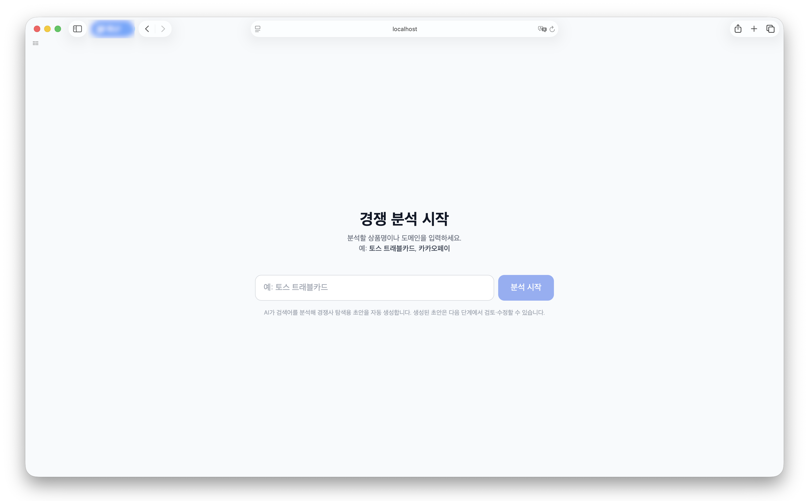

### 2-2. 질의 해석 초안 검토 (검토 지점 ①)
LLM이 앞선 단계에서 입력된 검색어를 기반으로 질의 해석 초안을 항목별 신뢰도, 추론 근거와 함께 보여 줍니다. 사용자는 잘못 추론된 항목을 고쳐 분석의 출발점을 확정합니다.

▶ **확정 후**: 자사 상품 ID(`own_*`)를 확정하고 두 작업을 병렬로 시작합니다.
- 경쟁사 후보를 발굴하고 ID를 정규화합니다(`comp_*`).
- 도메인 분석 체계(taxonomy)를 만듭니다. 분석 항목과 검색 키워드가 여기서 정해집니다.

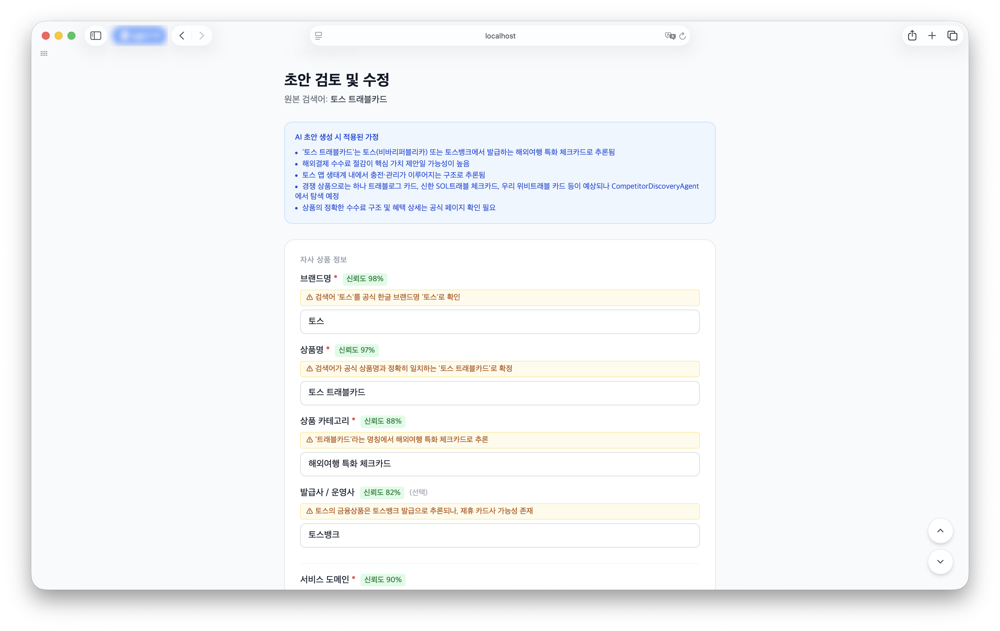

### 2-3. 경쟁사 선택 (검토 지점 ②)
브랜드 경쟁사 후보를 직접·간접·대체재 유형과 적합도 순으로 제시하고, 후보마다 선정 근거를 붙입니다. 사용자가 1~10개를 분석 대상으로 고릅니다.

▶ **선택 후**: 선택한 경쟁사와 자사의 공식 홈페이지 URL을 찾아 실제로 접속되는지 검증합니다.
- URL이 확정되면 공식 사이트, 블로그·커뮤니티, YouTube, 각 사 운영 채널, 시장 자료의 5개 출처에서 분석 항목별 근거 URL을 병렬로 탐색합니다.
- 최초 URL 탐색 혹은 검증에 실패하면
	1. Brave 검색과 LLM으로 자동 재탐색합니다.
	2. 재시도까지 실패한 항목이 있으면 **URL 재시도 화면(검토 지점 ③)**이 출력되고, 사용자가 URL을 직접 입력하거나 해당 경쟁사를 분석에서 제외합니다.
	3. 자사 URL을 검증하지 못하면 분석을 중단합니다.

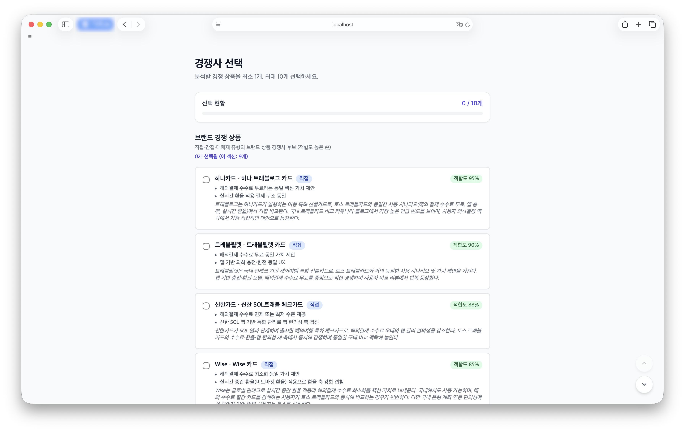

### 2-4. 분석 항목 선택 (검토 지점 ④)
생성할 리포트를 선택하며, 리포트별로 무엇을 분석할지 정하는 화면입니다. 리포트마다 진행 단계 안내(완료 / 선택 후 실행)를 보여 줍니다.

**비교 매트릭스**: 비교할 분석 항목(feature)을 고릅니다. 상품별로 근거 URL을 얼마나 확보했는지(확보·일부·없음)를 함께 보여 주므로, 근거가 부족한 항목을 미리 알 수 있습니다.

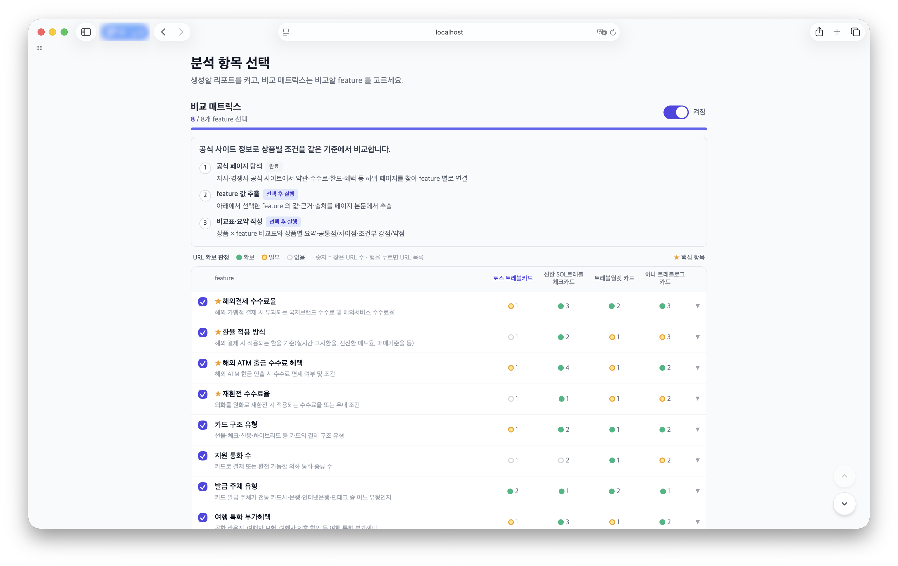

**고객 반응 인사이트**: 탐색을 마친 수집 대상을 보여 줍니다. YouTube 영상과 커뮤니티 게시글 수를 상품별, 사이트별로 확인할 수 있고, 각 사가 직접 운영하는 공식 YouTube 채널 영상은 광고, 홍보성이므로 수집 대상에서 제외합니다. 탐색된 공식 YouTube 채널은 수집 대상 하단에서 확인할 수 있습니다.

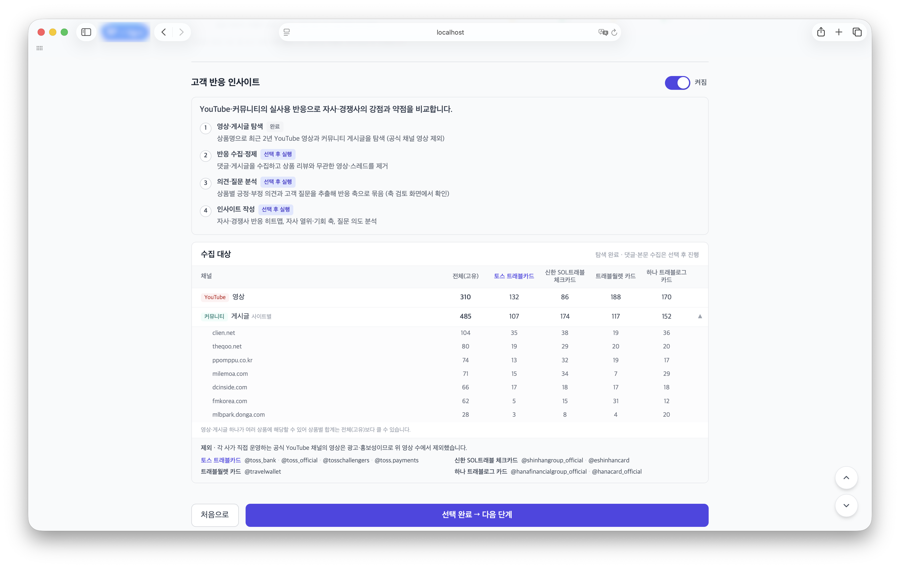

▶ **선택 완료 후**: 선택한 리포트에 따라 두 경로가 병렬로 실행됩니다.
- **비교 매트릭스 경로**: 공식 페이지 본문을 수집해 선택한 항목의 값, 근거, 출처를 추출하고 비교표를 만듭니다. 같은 자료로 기업 이력·재무·시장 외부 조사도 진행합니다.
- **고객 반응 경로**: 댓글과 게시글을 수집해 상품과 무관한 영상/글을 걸러낸 뒤, 상품별 긍정/부정 의견과 고객 질문을 뽑아 주제별로 군집화합니다.
- **통합**: 두 결과와 외부 조사를 합쳐 리서치 리포트를 작성합니다.

### 2-5. 결과: 비교 매트릭스 · 고객 반응 인사이트 · 리서치 리포트
분석이 끝나면 산출물 세 개를 탭으로 나눠 보여 줍니다.

**비교 매트릭스**: 공식 페이지 본문에서 추출한 값으로 상품별 설계, 공통점, 차이점을 정리합니다.

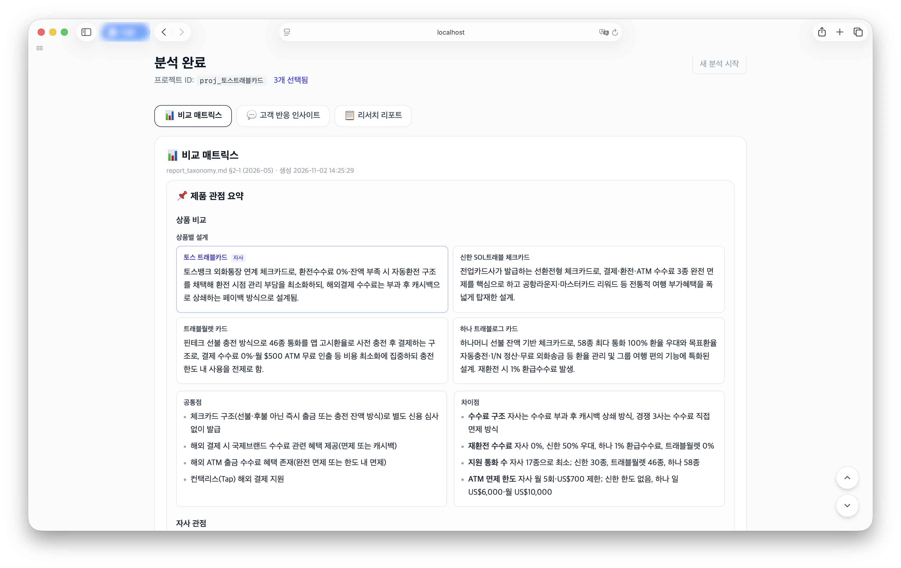

**고객 반응 인사이트**: YouTube 댓글과 커뮤니티 게시글에서 항목별 긍정·부정 반응과 질문 유형을 분석해 자사와 경쟁사를 비교합니다.

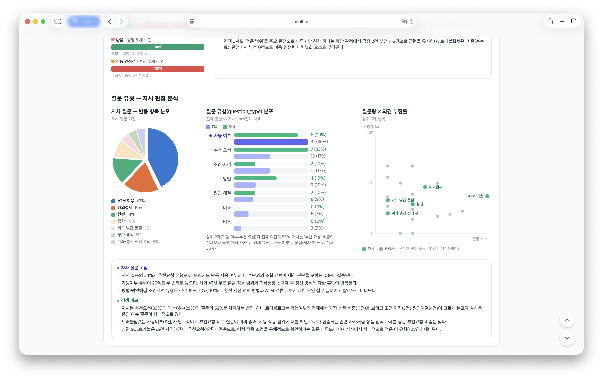

**리서치 리포트**: 비교 매트릭스, 고객 반응, 외부 조사(이력·재무·시장)를 합쳐 결론과 결정이 필요한 사항을 정리하여 리포트를 작성합니다. 각 수치에는 출처 번호를 붙여 근거를 추적할 수 있게 했습니다.

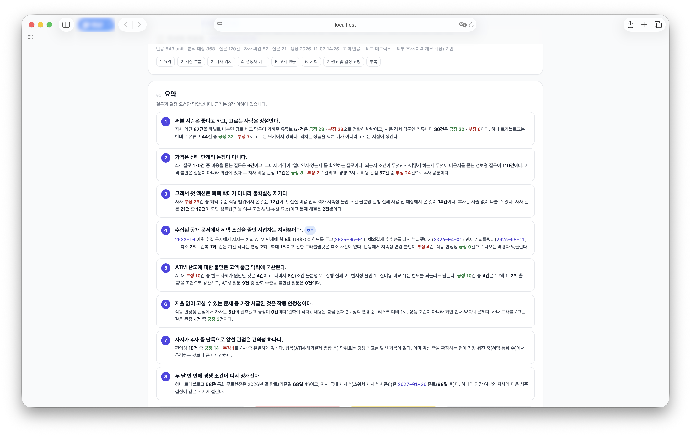

<details>
<summary>리서치 리포트 화면 더 보기 (자사 포지션 요약, 시장 흐름)</summary>

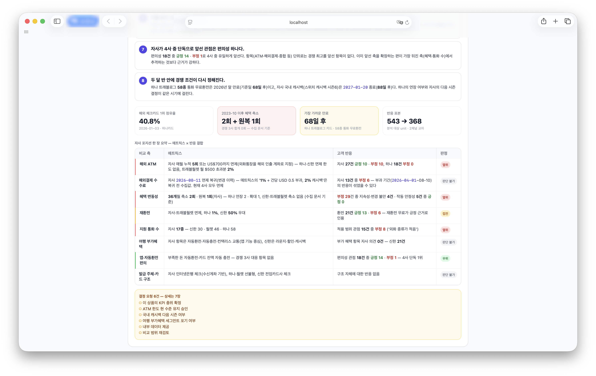

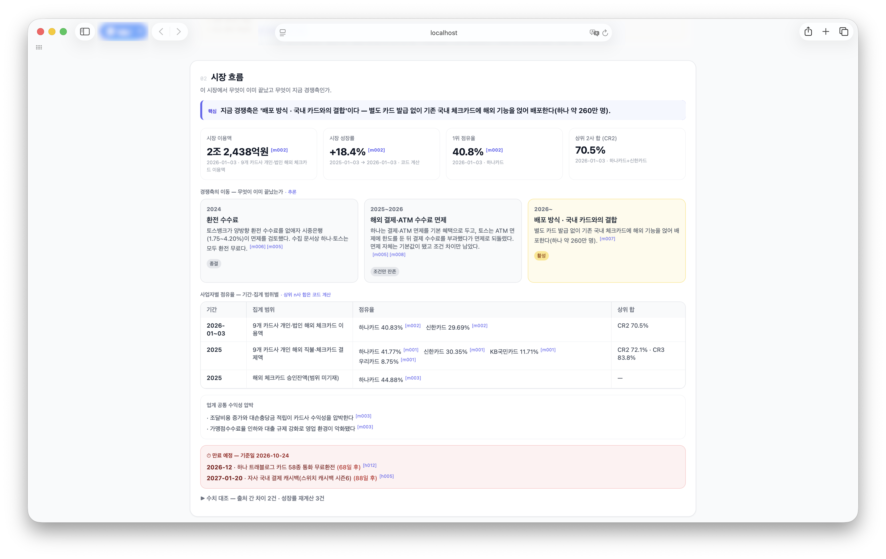

</details>

---

## 3. 동작 방식

### 3-1. 시스템 구성

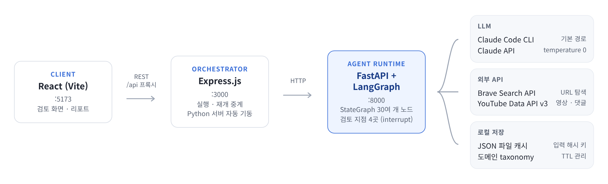

### 3-2. 분석 파이프라인

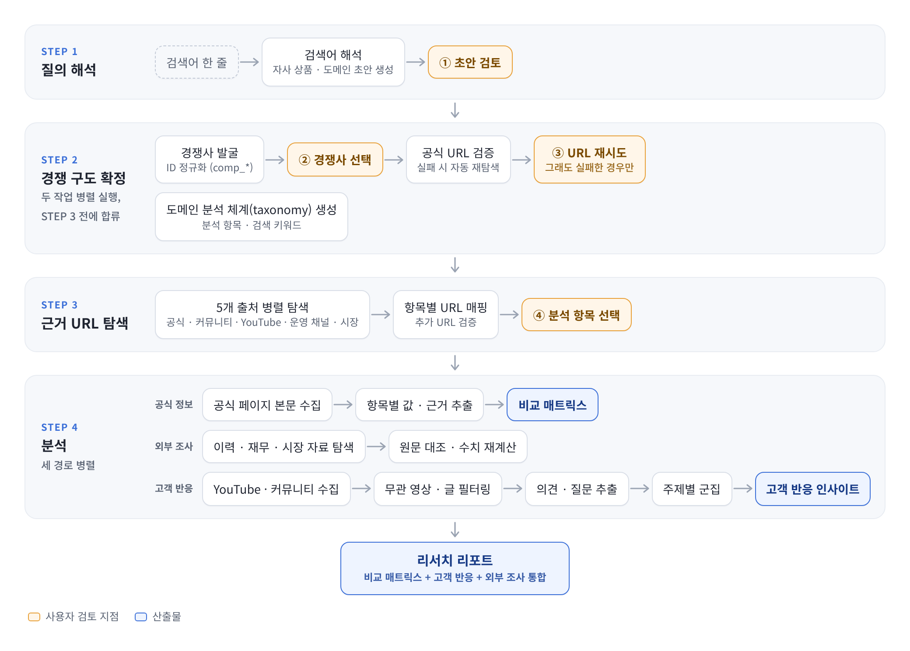

<details>
<summary>노드 단위 상세 그래프 보기 (LangGraph 노드 · 병렬 분기 · 합류 지점)</summary>

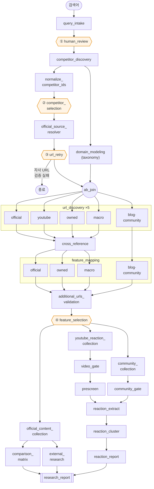

</details>

| 단계           | 하는 일                                                              | 사용자 개입 |
| ------------ | ----------------------------------------------------------------- | :----: |
| 1. 질의 해석     | 검색어에서 자사 상품, 도메인, 분석 방향 추출                                        |   ①    |
| 2. 경쟁 구도 확정  | 경쟁사 후보 발굴 → `comp_*` ID 정규화 → 공식 URL 검증과 재시도. 도메인 taxonomy는 병렬 생성 | ②, ③(검증 실패 시) |
| 3. 근거 URL 탐색 | 5개 소스 유형별 병렬 검색 → 교차 필터링 → 분석 항목별 URL 매핑                          |   ④    |
| 4. 공식 정보 분석  | 공식 페이지 본문 수집 → 비교 매트릭스, 외부 조사(이력·재무·시장)                           |   –    |
| 5. 반응 분석     | YouTube·커뮤니티 수집 → 무관한 영상·글 제거 → 의견·질문 추출 → 주제별 군집 → 반응 리포트       |   –    |
| 6. 통합        | 매트릭스·반응·외부 조사를 합쳐 리서치 리포트 생성                                      |   –    |

---

## 4. 설계 결정

### 4-1. LangGraph로 병렬 분기와 합류를 명시적으로 표현
경쟁사 확정과 도메인 taxonomy 생성은 서로 독립적이므로 병렬로 실행하고, 두 경로가 모두 끝났을 때만 다음 단계가 실행되도록 list fan-in barrier(`add_edge([A, B], C)`)로 합류시켰습니다. 합류 노드가 한 번만 실행되는지는 `scripts/verify_fanin.py`로 검증했습니다.

### 4-2. 완전 자동화 대신 검토 지점 4곳 설정
경쟁사 후보 하나가 잘못 들어가면 이후 URL 탐색, 비교, 반응 분석이 모두 오염됩니다. 노드 내부에서 LangGraph `interrupt()`를 호출해 4개 지점에서 사용자 확인을 받고, 프런트엔드는 받은 interrupt 값을 화면으로 그린 뒤 사용자 입력으로 파이프라인을 재개합니다.

### 4-3. LLM 호출 경로를 용도에 따라 분리
| 경로 | 용도 | 이유 |
|---|---|---|
| Claude Code CLI | 대부분의 에이전트 호출 | 비용 효율 |
| Claude API (`temperature=0`) | 경쟁사 ID 확정 등 | 같은 입력에 같은 출력이 필요한 곳만 사용 |

모든 호출은 `call_with_schema(prompt, output_schema)`로 JSON Schema를 강제합니다.

### 4-4. 캐시를 먼저 조회하는 호출 구조
에이전트 출력은 `agent_id` + 입력 해시 + 컨텍스트 해시(프롬프트·스키마·모델) 키로 캐시하고, 노드별 TTL은 `server/cache_ttls.yaml`에서 한곳에서 관리합니다. 같은 도메인을 다시 분석할 때 비용과 지연을 줄이고 결과를 재현할 수 있게 하기 위한 구조입니다.

### 4-5. 수집한 고객 반응 데이터는 전처리 후 LLM에 입력
수집한 댓글과 게시글을 모두 LLM에 보내지 않고, 단계별로 걸러낸 뒤 분석해 비용과 처리 시간을 줄였습니다.

1. **영상·게시글 필터링**: 상품 리뷰나 사용기가 아닌 영상과 게시글을 제외합니다.
2. **댓글 필터링**: 의미 없는 짧은 댓글과 상품과 무관한 대화를 제외합니다(YouTube).
3. **의견 단위로 쪼개기**: 남은 글을 "어떤 상품의 어떤 항목에 대한 긍정·부정 의견"이라는 작은 단위로 나눕니다. 예를 들어 "환전은 편한데 ATM 출금이 자꾸 실패해요"라는 댓글 하나는 `환전 · 긍정`, `ATM 이용 · 부정`이라는 의견 두 개가 됩니다. 이렇게 나눠야 댓글 하나에 섞인 여러 평가를 항목별로 따로 집계할 수 있습니다. 고객 질문도 이 단계에서 따로 뽑습니다.
4. **주제별 군집**: 비슷한 의견과 질문을 "ATM 이용", "환율", "작동 안정성" 같은 반응 주제로 군집화해 자사와 경쟁사를 비교합니다.

**예시 실행(토스 트래블카드 외 경쟁 상품 3개)의 단계별 처리량**

| 단계 | YouTube | 커뮤니티 |
|---|---|---|
| 수집 | 영상 310개 · 댓글 36,605개 | 게시글 485개 (본문 확보 456개) |
| 1. 영상·게시글 필터링 | 영상 99개 통과 (32%) · 댓글 5,949개 | 게시글 155개 통과 (34%) |
| 2. 댓글 필터링 | 댓글 묶음(스레드) 2,456개 판정 → 1,449개 통과 (중요도 2점 이상) | 생략 (게시글 1개 = 묶음 1개, 중요도는 1단계에서 함께 매김) |
| 분석 상한 적용 | 중요도 3점 461개 중 113개 | 중요도 3점 36개 중 30개 |
| 3. 의견 단위로 쪼개기 | 의견 251개 · 질문 111개 | 의견 292개 · 질문 59개 |

**분석 상한은 이렇게 적용합니다.** 필터링 단계에서 LLM이 스레드(커뮤니티는 게시글)마다 0~3점의 중요도를 함께 부여합니다. 기준은 도메인 관련성, 상품 간 비교 여부, 사용 경험의 구체성, 분석 대상 상품 언급 정도이며, 3점은 "특정 상품에 대한 구체적 비교·수치·상세 사용 경험"입니다. 2점 이상만 남긴 뒤 상한(YouTube 113개, 커뮤니티 30개)을 넘으면 점수가 높은 순으로 자릅니다. 이번 실행에서는 3점만 해도 YouTube 461개, 커뮤니티 36개로 상한보다 많아, 모두 3점인 스레드 중 수집 순서상 앞선 것이 선택되었습니다.

- 최종 의견 543개 중 **분석 대상 4개 상품에 귀속된 368개**를 비교에 사용했습니다. 나머지 175개는 다른 카드에 대한 의견이거나 특정 상품을 가리키지 않는 일반 의견입니다. 질문 170개는 별도로 분석합니다.
- YouTube 댓글 원문 약 237만 자 가운데, 가장 무거운 의견 추출 단계에 들어간 분량은 약 5.7만 자(**2.4%**)입니다. 댓글 필터링 단계까지 합쳐도 LLM이 읽은 분량은 약 58만 자(**약 25%**)입니다.

### 4-6. 오류 격리
모든 노드에 `try-except`를 적용하고, 치명적이지 않은 오류는 `errors` 누적 필드에 기록한 채 계속 진행합니다. 자사 URL을 검증할 수 없을 때처럼 치명적인 경우에만 조건부 분기로 종료합니다.

---

## 5. 개선 과정과 성과

고객이 분석 대상 상품에 대해 Youtube와 커뮤니티에 작성한 경험, 의견, 질문 데이터를 수집 및 전처리하는 도구로 LLM을 사용했습니다. 아래 개선은 LLM에 보내는 **입력의 단위, 분량, 호출 횟수**를 코드로 설계한 결과이며, 정확도를 유지하면서 처리 실패를 없애고 비용을 줄였습니다. 개선 수치는 모두 같은 표본에 방식만 바꿔 비교한 실험(PoC) 결과입니다.

>(참고) 전처리 각 단계는 대량의 텍스트 데이터를 처리하기 위해 동일 역할 LLM을 N개 병렬 실행합니다.

| 개선                      | 목적  | 기존 방식                                                                     | 바꾼 방식                                        | 결과                                                                                   |
| ----------------------- | --- | ------------------------------------------------------------------------- | -------------------------------------------- | ------------------------------------------------------------------------------------ |
| 입력 분할 크기<br>(의견 추출)     | 안정성 | - LLM 당 스레드를 12,000자 단위로 크게 묶어 보냄<br>- 댓글이 많은 영상 데이터를 처리하는 LLM에서 시간 초과 발생 | 스레드를 쪼개지 않는 선에서 1,500자 단위로 나눠 보냄             | 200개 스레드 중 처리 실패 **176개 → 0개**                                                       |
| 입력 맥락 축소<br>(의견 추출)     | 비용  | 댓글 해석 정확도 향상을 위해 영상 설명, 게시글 본문 등 맥락 전체를 매번 함께 보냄                          | 상품명과 부가 서비스 목록만 보냄                           | - 맥락 길이 **2,279자 → 387자(−83%)<br>- **추출 의견 수(253 → 252)와 상품 귀속 정확도(0.818 → 0.817) 유지 |
| 호출당 처리량<br>(댓글 필터링)     | 비용  | 한 번 호출에 스레드 25개씩 판정                                                       | 40개씩 판정해 호출 횟수를 줄임                           | - 비용 **−40.4%**<br>- 기존 방식과 판정 일치율 **98.4%** (258개 스레드)                              |
| 규칙 기반 사전 제외<br>(댓글 필터링) | 비용  | 모든 스레드를 LLM으로 판정                                                          | 핵심 키워드가 없고 40자 미만인 스레드는 Python 코드 규칙으로 먼저 제외 | - **8.5%를 LLM 호출 없이 제외**<br>- 놓친 유효 스레드 **0건**                                       |

---

## 6. 기술 스택

| 레이어           | 기술                                    |
| ------------- | ------------------------------------- |
| Frontend      | React + Vite, Tailwind CSS            |
| Orchestrator  | Node.js 20+, Express.js               |
| Agent Runtime | Python 3.11+, FastAPI, uvicorn        |
| Workflow      | LangGraph StateGraph + MemorySaver    |
| LLM           | Claude (Code CLI 기본 / API 결정론 경로)     |
| 외부 API        | Brave Search API, YouTube Data API v3 |
| 저장            | JSON 파일 캐시(입력 해시 키, YAML로 TTL 관리)     |

---

## 7. 실행 방법

> macOS 로컬 단일 사용자 환경을 기준으로 개발했습니다.

### 사전 요구사항
- Node.js 20+, Python 3.11+
- [Claude Code CLI](https://docs.claude.com/en/docs/claude-code/overview) 설치 및 로그인
- API 키: Anthropic, Brave Search, YouTube Data API v3

### 설치와 실행
```bash
# 1. Python 가상환경 (Express가 .venv/bin/python3로 FastAPI를 자동 기동)
python3 -m venv .venv
.venv/bin/pip install -r requirements.txt

# 2. Node 의존성
npm install
cd client && npm install && cd ..

# 3. 환경 변수
cp .env.example .env   # 아래 필수 키 입력

# 4. 실행 (터미널 2개)
npm run dev                 # Express :3000 + FastAPI :8000 자동 기동
cd client && npm run dev    # React :5173 → http://localhost:5173 접속 (/api 요청은 :3000으로 프록시)
```

| 필수 키                   | 용도                            |
| ---------------------- | ----------------------------- |
| `ANTHROPIC_API_KEY`    | Claude API (결정적 결과가 필요한 에이전트) |
| `BRAVE_SEARCH_API_KEY` | URL 탐색                        |
| `YOUTUBE_API_KEY`      | YouTube 영상·댓글 수집              |

---

## 8. 프로젝트 구조

```
competitive-intel/
├── agents/              # 에이전트별 system_prompt_kr.md + output.schema.json
├── client/              # React (Vite) 클라이언트
├── server/
│   ├── index.js         # Express 오케스트레이터
│   ├── pythonServer.js  # FastAPI 자동 기동
│   ├── config.py        # 환경 변수·모델 설정
│   ├── cache_ttls.yaml  # 노드별 캐시 TTL
│   ├── llm/             # Claude CLI / API 어댑터, YouTube 클라이언트
│   └── graph/
│       ├── graph.py     # StateGraph 정의 (노드·엣지·fan-in)
│       ├── state.py     # DomainAnalysisState
│       ├── nodes/       # 노드 구현
│       ├── reaction/    # 반응 분석 모듈
│       └── insight/     # 리서치 리포트 모듈
├── data/taxonomy/       # 도메인 taxonomy
├── docs/                # 설계 문서, 리포트 Rubric, 측정 기록
└── scripts/             # 검증·측정 스크립트, 테스트
```

---

## 9. 한계와 다음 단계

**알려진 한계**
- MemorySaver 체크포인터라 로컬 단일 사용자만 지원합니다.
- YouTube Data API 일일 쿼터와 Brave Search 요청 속도 제한에 따라 수집량이 제한됩니다.
- Claude Code CLI는 temperature를 지정할 수 없어, 결정론이 필요한 호출은 API 경로로 분리했습니다.

**다음 단계**
- SQLite 체크포인터와 영구 저장소 전환
- 파일럿 외 도메인(통신, 예적금) 검증 확대

---

## 10. 문서

| 문서                                                           | 내용                |
| ------------------------------------------------------------ | ----------------- |
| [`docs/Design_Spec.md`](docs/Design_Spec.md)                 | 전체 설계             |
| [`docs/Development_Roadmap.md`](docs/Development_Roadmap.md) | 단계별 구현 순서         |
| [`docs/design/`](docs/design/)                               | 노드별 설계 결정 기록      |
| [`docs/reference/`](docs/reference/)                         | 7종 리포트 Rubric과 예시 |
| [`CHANGELOG.md`](CHANGELOG.md)                               | 버전별 변경 이력         |

---

## 데이터 및 이용 고지

- 이 저장소는 개인 포트폴리오 프로젝트이며, 분석 예시에 등장하는 기업·상품과는 관련이 없습니다.
- 코드는 MIT License를 따릅니다.
- 수집 데이터와 분석 예시 결과물은 라이선스 대상이 아니며, 각 원저작자와 플랫폼의 약관을 따릅니다.
- 원본 수집 데이터와 캐시는 저장소에 포함하지 않습니다.

## 만든 사람

**[김태호 (TaeHo Kim)]**  [데이터 분석가]

[반복되는 업무를 에이전트로 자동화하는 데 관심이 있습니다. 이 프로젝트는 여러 프로젝트에서 겪은 리서치 과정의 불편과 비효율에서 출발했습니다.]

**개인 프로젝트로, 기획부터 구현·검증까지 혼자 진행했습니다.**
- 기획: [예: 문제 정의, 리포트별 평가 기준(Rubric), 사용자 검토 지점 4곳 설계]
- 백엔드: [예: LangGraph 노드 30여 개, 병렬 분기/합류 구조, 캐시 전략, 외부 API 연동]
- 프런트엔드: [예: 검토 화면 4종과 결과 리포트 3종 구현]
- 검증: [예: 단계별 실험(PoC)으로 처리 방식과 모델 선정, 수치 근거 확보]

**개발 방식**: [예: Claude Code를 개발 보조 도구로 활용해 설계, 구현, 검증을 진행했습니다.]

**연락처**
- GitHub: [@Adn-thkim](https://github.com/Adn-thkim)
- E-mail: [tae1094@gmail.com]
- Phone: [010-7924-1322]
